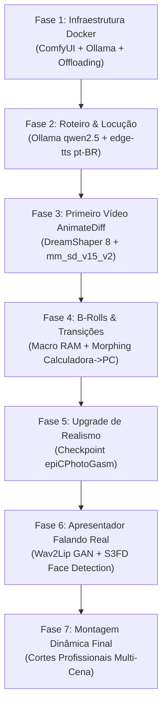

# Evolução do Projeto: Pipeline Local de Vídeo com IA, Lições Aprendidas e Arquitetura

> **Hardware de Referência:** NVIDIA GeForce RTX 2060 (6 GB VRAM) | 32 GB RAM | Windows 11 (Docker + WSL2)  
> **Objetivo:** Criar um ambiente 100% local e automatizado para produção de vídeos explicativos de tecnologia (ex: *"Como funciona a Memória RAM"*), com roteiro, narração neural em Português, vídeo cinematográfico e apresentador com sincronia labial (*lip-sync*).

---

## 1. Linha do Tempo e Evolução do Projeto



### Fase 1: Fundação da Infraestrutura Docker
- **Desafio:** Rodar modelos generativos pesados em uma GPU de 6 GB VRAM compartilhada com Ollama e Open WebUI.
- **Implementação:**
  - Adicionado o serviço `comfyui` no `docker-compose.yml` utilizando a imagem `yanwk/comfyui-boot:cu126-slim`.
  - Flags de otimização de memória ativadas: `--lowvram --preview-method auto --enable-manager`.
  - Configurado `OLLAMA_KEEP_ALIVE=0` no container do Ollama para liberar imediatamente a VRAM após a geração do texto.
  - Mapeamento de volumes persistentes em `./storage/comfyui/...` para modelos, checkpoints e outputs.

### Fase 2: Roteiro e Narração Neural
- **Desafio:** Produzir uma locução fluida em português brasileiro com ritmo natural e sem custos de APIs externas.
- **Implementação:**
  - Roteirização através do Ollama local (`qwen2.5:7b`).
  - Geração de áudio com `edge-tts` usando a voz neural masculina `pt-BR-AntonioNeural` (e opção feminina `pt-BR-FranciscaNeural`).
  - Resultado: Faixa de áudio cristalina de 23,3 segundos (`storage/comfyui/input/narracao_ram.mp3`).

### Fase 3: Geração de Vídeo Inicial com AnimateDiff
- **Desafio:** Gerar vídeo a partir de texto sem estourar os 6 GB de VRAM.
- **Implementação:**
  - Instalação dos nós `ComfyUI-AnimateDiff-Evolved` e `ComfyUI-VideoHelperSuite`.
  - Utilização do checkpoint SD1.5 `DreamShaper_8_pruned.safetensors` com o módulo de movimento `mm_sd_v15_v2.ckpt`.
  - Configuração de batches conservadores de 16 a 24 quadros a 512x512.
- **Limitação Identificada:** O modelo de difusão fazia o personagem se mover de forma estilizada e balançar a cabeça, mas **não sincronizava a boca com as palavras faladas**.

### Fase 4: Enriquecimento Visual (B-Rolls de Hardware e Transições)
- Para tornar o vídeo dinâmico e não depender apenas de um plano fixo do apresentador:
  1. **Transição Morphing Calculadora $\rightarrow$ PC Gamer RGB:**
     - Criado o fluxo `workflows/transicao_calculadora_pc.json`.
     - Utilizou `ADE_PromptScheduling` com interpolação esférica (`slerp`), dissolvendo uma calculadora mecânica antiga de engrenagens em um computador moderno transparente com luzes RGB.
  2. **B-Roll Macro de Memória RAM:**
     - Criado o fluxo `workflows/hardware_broll_memoria_ram.json`.
     - Tomadas em close-up extremo revelando os contatos dourados, chips e pulsos de dados em placas de circuito DDR5.

### Fase 5: Upgrade de Realismo Fotográfico
- **Problema:** O `DreamShaper 8` gerava pessoas com visual semi-ilustrado, lembrando arte digital 3D ou pintura digital.
- **Solução:**
  - Substituição pelo checkpoint focado em fotografia realística: `epiCPhotoGasm` (`epicphotogasm_v1.safetensors`).
  - Ajuste de prompts negativos para eliminar o efeito de "pele plástica/boneco de cera" (*wax figure, airbrushed, cartoon, doll*).
  - Geração de retratos nítidos com iluminação de estúdio e textura de pele natural.

### Fase 6: O Salto do Apresentador Real (Wav2Lip Lip-Sync)
- **Descoberta Chave:** Nenhum modelo Text-to-Video de difusão pura (como AnimateDiff ou CogVideo) é capaz de fazer sincronia labial fonética por texto, pois eles não possuem um codificador de áudio para fonemas.
- **Solução Definitiva:**
  - Instalação e integração do `ComfyUI_wav2lip` com a rede neural adversária `wav2lip_gan.pth` (435 MB).
  - Pré-carregamento do modelo de detecção facial S3FD (`s3fd.pth`, 89 MB) para garantir execução autônoma offline.
  - Correção interna no leitor de áudio (`soundfile`) para evitar falhas do `torchcodec` em contêineres CUDA.
  - **Resultado:** Renderização de **701 frames (23,3 segundos)** em **apenas 50 segundos** na RTX 2060, com a boca e a mandíbula se movendo em perfeita sincronia com o português falado.

### Fase 7: Montagem Dinâmica Final com FFmpeg
- Criação do roteiro de edição que intercala o apresentador falando com as tomadas de cobertura:
  - **0s a 6s:** Apresentador falando (Introdução com Lip-Sync real).
  - **6s a 13s:** Tomada macro dos chips e circuitos da memória RAM DDR5.
  - **13s a 18s:** Transição *morphing* da calculadora antiga para o PC Gamer moderno.
  - **18s a 23,3s:** Retorno para o apresentador finalizando a explicação (fechamento em sincronia labial).

---

## 2. Lições Aprendidas e Otimizações de Engenharia

### 1. Gestão Rigorosa de VRAM (6 GB é viável com a arquitetura correta)
- **ComfyUI `--lowvram`:** Permite que pesos de modelos maiores sejam descarregados (*offloaded*) para a memória RAM do sistema (32 GB) dinamicamente durante a inferência.
- **Ollama Coexistente:** Modelos LLM no Ollama retêm VRAM por padrão por 5 minutos. Definir `OLLAMA_KEEP_ALIVE=0` no compose é mandatório para permitir que o ComfyUI utilize 100% dos 6 GB da GPU.
- **Batch Size e Resolução:** Em SD1.5 + AnimateDiff, resoluções acima de 512x512 ou batches acima de 24 frames geram risco crítico de CUDA Out of Memory (OOM). 512x512 provou ser o *sweet spot* de velocidade e estabilidade.

### 2. O Erro Comum: "Pedir para o AnimateDiff falar"
- Modelos de difusão como AnimateDiff interpolam ruído latente ao longo do tempo. Quando solicitados com `"person talking"`, eles apenas criam movimentos aleatórios de cabeça e aberturas genéricas de lábios.
- **Arquitetura Correta:**
  $$\text{Foto Realista (Checkpoint)} + \text{Voz Real (TTS)} \xrightarrow{\text{Wav2Lip}} \text{Vídeo com Lip-Sync Realista}$$
- O Wav2Lip isola a região facial inferior, aplica o espectrograma mel do áudio e sintetiza os lábios quadro a quadro com altíssima fidelidade e velocidade 10x maior que a difusão completa.

### 3. Cache do Navegador no ComfyUI
- Ao baixar novos arquivos `.safetensors` ou `.ckpt` enquanto a aba do ComfyUI está aberta, a interface continuará exibindo *"modelo ausente"* nos seletores porque a lista foi requisitada no carregamento da página. Um simples `F5` atualiza a lista de nós e modelos disponíveis sem necessidade de reiniciar o container.

### 4. Padrões de Áudio e Vídeo no ComfyUI
- Os nós padrão do tipo `SaveAnimatedWEBP` não possuem suporte nativo a trilhas de áudio e causam conflitos de tipo no frontend.
- O padrão profissional adotado foi o `VHS_VideoCombine` (da suíte VideoHelperSuite) configurado para:
  - Formato: `video/h264-mp4`
  - Pixel Format: `yuv420p` (garante compatibilidade universal com qualquer reprodutor e navegador)
  - Codec de áudio: `AAC` estéreo 192 kbps.

---

## 3. Estrutura de Arquivos e Componentes Produzidos

```text
c:\Projetos\ia-local\
├── docker-compose.yml                     # ComfyUI (lowvram) + Ollama + Open WebUI
├── workflows/                             # Fluxos visuais para carregar no ComfyUI
│   ├── apresentador_lipsync_wav2lip.json  # Fluxo visual de sincronização labial Wav2Lip
│   ├── apresentador_ultra_realista.json   # Fluxo AnimateDiff + epiCPhotoGasm
│   ├── transicao_calculadora_pc.json      # Fluxo de morphing calculado por interpolação SLERP
│   └── hardware_broll_memoria_ram.json    # Fluxo macro cinematográfico de peças de PC
├── scripts/                               # Automações completas em Python
│   ├── gerar_apresentador_lipsync.py      # Pipeline 1-clique: TTS + Wav2Lip + Render
│   ├── montar_video_apresentador_real.py  # Montador dinâmico FFmpeg (Apresentador + B-Rolls)
│   ├── gerar_roteiro_e_video.py           # Pipeline ponta a ponta (Ollama + TTS + ComfyUI)
│   ├── gerar_transicao_calculadora.py     # Automação do vídeo de transição
│   └── download_models.ps1                # Script interativo para download de modelos
└── storage/comfyui/
    ├── models/checkpoints/                # epicphotogasm_v1, DreamShaper_8
    ├── models/animatediff_models/         # mm_sd_v15_v2.ckpt
    ├── custom_nodes/                      # ComfyUI-Manager, AnimateDiff, VHS, Wav2Lip
    └── output/                            # Vídeos finais gerados prontos para uso
        ├── VIDEO_APRESENTADOR_REAL_RAM_FINAL.mp4  # Vídeo completo editado com cortes
        ├── apresentador_lipsync_00001-audio.mp4   # Vídeo isolado com lip-sync total
        ├── broll_ram_macro_00001.mp4              # Take macro da RAM
        └── transicao_calculadora_pc_00001.mp4     # Take morphing calculadora -> PC
```

---

## 4. Guia Rápido de Uso para Novos Vídeos

### Método 1: Criação Rápida por Script (Recomendado)
Para gerar um novo vídeo de apresentador sincronizado com qualquer texto:
```powershell
# 1. Gera a locução e o vídeo sincronizado com Wav2Lip:
python scripts/gerar_apresentador_lipsync.py

# 2. Monta o vídeo final dinâmico intercalando o apresentador e os B-rolls de tecnologia:
python scripts/montar_video_apresentador_real.py
```

### Método 2: Interface Web do ComfyUI
1. Abra [http://localhost:8188](http://localhost:8188) no navegador.
2. Arraste para a tela o arquivo [`workflows/apresentador_lipsync_wav2lip.json`](file:///c:/Projetos/ia-local/workflows/apresentador_lipsync_wav2lip.json).
3. Selecione a imagem base desejada e o áudio da narração.
4. Clique em **Executar** (*Queue Prompt*).

